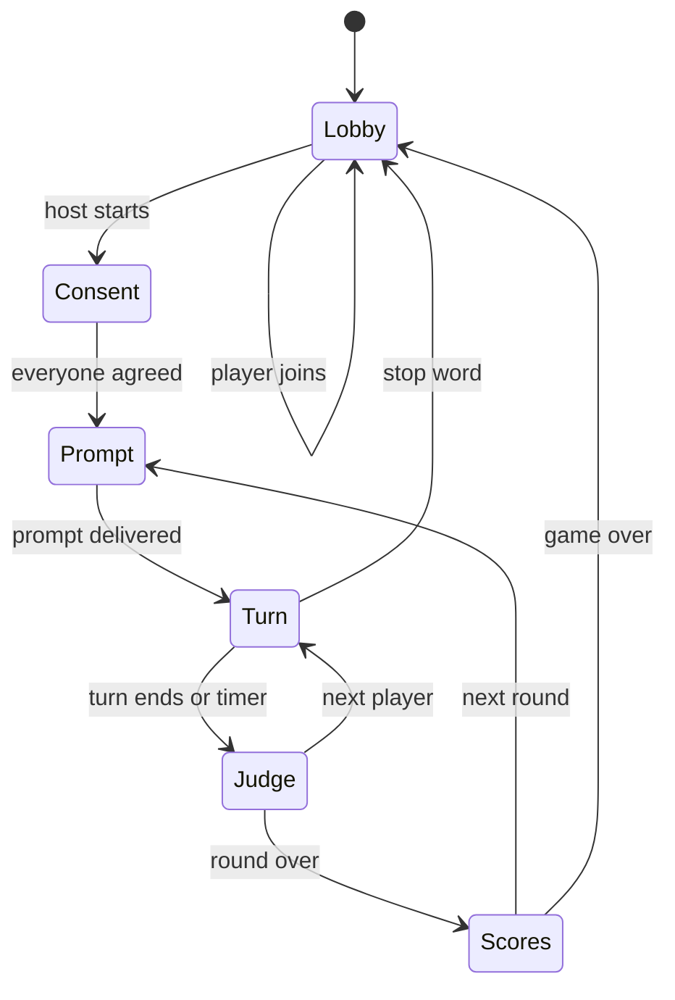

# Party-game device: product brief

Working notes from the first research pass (2026-11-20). Web sources were read through
search summaries, not full pages, so treat figures as leads to confirm. Items marked
*(estimate)* are inferences, not sourced facts.

## 1. What it is

A screenless doughnut that sits in the middle of the table and hosts party games. It sees
the room through one camera eye, hears through its mics, talks through a speaker, and uses
players' phone browsers as private screens. No app. All AI runs in the cloud.

The joke is the object itself: it looks like the AI gadget everyone is waiting for, and it
uses those powers to roast you.

## 2. Form factor: what to parody

OpenAI and Jony Ive's device has not been announced, shown or named. No official images exist.

| Source | Date | Claim |
|---|---|---|
| Bloomberg (Gurman) | 2026-08 | Doughnut-shaped smart speaker, about hockey-puck size, no display; grilles, mics, lights, a camera; moving parts that show when it is listening. $300–400, launch 2027. |
| The Information | 2026-02 | Smart speaker with camera and facial recognition, $200–300, February 2027 at the earliest. |
| iyO court filings | 2025-06 | Prototype is not an in-ear device and not a wearable. |
| Ming-Chi Kuo | 2025-05 | Neck-worn, iPod Shuffle sized. Superseded by the above. |

No source gives dimensions, materials or colours. A hockey puck is 76 × 25 mm.

The cues worth copying are the doughnut, the puck scale, no screen, one eye, and a light
that shows it is listening. `hardware/enclosure` implements those.

Parodying a rumoured shape is low risk while nothing has been shown. Once the real product
exists, a near-identical commercial copy is a different matter: US courts no longer give
parody products an automatic pass on trade dress (Jack Daniel's v. VIP Products, 2023).
Keep the name, logo and packaging clearly its own, and get a lawyer's view before retail.

## 3. Hardware

### This week (prototype)

| Item | Why | About |
|---|---|---|
| Seeed XIAO ESP32S3 Sense × 2 | Camera + PDM mic + Wi-Fi in 21 × 17.8 × 15 mm; official CAD exists | $14–20 each |
| MAX98357A I2S amp | 3 W into 4 Ω | $6 |
| 40 mm 4 Ω 3 W speaker (or 28 mm for the small shell) | A 0.5 W mini speaker is too quiet for a party | $6 |
| ST25DV16K NFC breakout + NTAG215 stickers | Tap-to-join | $6 + a few dollars |
| Waveshare ESP32-S3-CAM-OV5640 | Same chips as the planned custom board (ES7210 dual-mic ADC, ES8311 codec); use as firmware reference | $17–20 |

The Raspberry Pi already on hand, with any USB webcam and mic, can run the whole game loop
today. Build the cloud pipeline and the games on it while the ESP32 parts ship; the device
firmware then only has to stream audio and frames.

### Decisions

- **No battery in v1.** USB-C power only. A battery adds UN38.3 test summaries, UN3481
  packaging and Amazon FBA paperwork. Runtime would be fine (roughly 6–9 h on 2000 mAh,
  *estimate*); the burden is shipping and certification. Users can plug into a power bank.
- **Echo cancellation is the real audio problem**, not mic count. One mic is enough for
  cloud transcription at 1–2 m. The device's own speaker is what wrecks it, so either run
  half-duplex (stop listening while talking) or use two mics plus a playback reference with
  Espressif's audio front end. Two mics do not improve cloud speaker separation *(estimate)*.
- **Onboarding without an app:** the device opens a Wi-Fi access point with a captive
  portal; a QR code on the base joins it. This is the only app-free path that works on both
  iOS and Android. Web Bluetooth does not exist on iOS.
- **Tap to join:** a dynamic NFC tag (ST25DV04K, about $0.50 at volume) lets the device
  rewrite its URL with the current room code. iPhones read it in the background and show a
  notification to tap. A QR code and a 4-letter room code are the fallback.
- **Cellular** would remove Wi-Fi setup but costs about $1–1.50 per hour of play in data
  *(estimate)* and adds carrier certification. Skip for v1.
- **Stock camera lens is narrow** (about 55° horizontal). A 160° module sees the whole
  table. The enclosure aims the eye 30° up.

### Cloud pipeline

Streaming speech-to-text with speaker labels, then a text LLM, then on-demand speech.
About $1–2 per hour of play *(estimate)*. A fully speech-to-speech realtime model is
$3–9 per hour *(estimate)* and does not label speakers.

### Custom board

ESP32-S3-WROOM-1 module (pre-certified, FCC ID 2AC7Z-ESPS3WROOM1), camera, ES7210 + ES8311,
2 mics, amp, ST25DV04K, 12 LEDs, USB-C. Assembled board about $14–18 at 1,000 units
*(estimate)*, before speaker enclosure, plastics and packaging. JLCPCB assembles in 2–5
days when every part is in their stock, plus 3–7 days shipping. The finished product still
needs FCC Part 15B emissions testing, about $1.5–4k *(estimate)*.

## 4. Games

Phones join by tap, QR or room code, browser only. The device is the host and the shared
voice; phones are private inputs and private screens.

### A. Roast mode (performed out loud, AI judges)

| Game | Round |
|---|---|
| 185 | "185 ___ walk into a bar…" Players step into frame and deliver a pun on the device's noun. Bell or buzzer per pun. |
| World's Worst | Device names a category; one-liners in turn; scored on the room's laughter. |
| Questions Only | Two players hold a scene using only questions. A statement or a stall gets buzzed. |
| Story, Story, Die | The light points at a player, who must continue mid-sentence. Hesitate or repeat and you are out. |
| Receipts trivia | Questions built from what players said earlier in the night. "Who claimed they could 'definitely' beat a goose in a fight?" |

The device critiques each turn in character. Laughter volume is a usable score signal and
needs no speaker labels.

### B. Phone mode (private input, shared reveal)

| Game | Round |
|---|---|
| Two-prompt duel | Everyone answers two prompts on their phone; each prompt goes to two players; the room votes; the device reads the answers aloud and heckles. |
| Lie to the machine | A fact with a blank. Everyone writes a lie. Find the truth; score for each player you fool. |
| Forehead | Phone on your forehead shows a word you cannot see. Tilt down for correct, up for pass. The device gives the clues, or judges the room's. |
| Draw | Draw a prompt on your phone; others caption it; vote. |

AI video of a player's face is not feasible on the device and costs real money and consent
problems in the cloud. Leave it out of v1.

### C. Connection mode (no scores, no roasting)

Adapted from Authentic Relating games. The device only reads prompts and keeps time.

| Game | Round |
|---|---|
| Noticing | Pairs alternate: "Sitting here with you, I notice…" / "Hearing that, I notice…" 2–5 minutes. |
| Curiosity | A asks only questions they are truly curious about. B may decline any. Then B says which questions landed. |
| Hot Seat | One person picks mild, medium or spicy. Anyone asks. The only reply allowed from askers is "thank you". |
| Anybody Else? | One person says something true of them and asks "anybody else?" Everyone it fits raises a hand. |
| Sentence stems | "If you really knew me, you'd know…" "Something I appreciate about you…" |

Agreements read aloud before every session: you can pass on anything; share what happened,
not who said it; speak for your own experience.

**Hard mode.** Challenge Day's "cross the line" format has documented problems when run
without trained facilitators: people disclose in public, then get no follow-up. A consumer
device should not run trauma-category prompts at all. Hard mode means deeper stems and
longer silences, not heavier topics.

Rules for this mode, enforced in software:

- Every player opts in on their own phone. Intensity defaults to mild.
- Passing is silent and free. The device never announces a refusal.
- Mic audio is used only to keep time. No transcript, no memory, no roast material taken from it.
- No scoring, no judging, no escalation by the AI.
- A stop word ends the mode at once.
- Adults only. "This is a game, not therapy" on the first screen.
- If someone sounds in distress, pause and show crisis resources (988 in the US).

### Game flow

Every game is a small state machine, which is what this repo's sandbox draws:

Next step for the sandbox: export a diagram as JSON (states, transitions, timers) so a
game can be drawn here and run by the game server.

## 5. Privacy

A camera and mic recording party guests is the product's biggest liability and should be
its loudest design feature.

- Speaker labels are per-session ("Player 3"), tied to the name a player typed on their
  phone. Nothing persists after the session ends.
- Recognising people by voice or face is biometric data under laws such as Illinois BIPA.
  Do not store voiceprints or face embeddings. Use the camera for "someone stepped into
  frame" and scene description, not identity.
- The light ring is on whenever the mic or camera is live. A hardware mute is worth its cost.
- Every player consents on their own phone before the first round.

## 6. Money

### What the comparisons say

| Product | Price | Result |
|---|---|---|
| We're Not Really Strangers | $20–25 at Target | Instagram-born; "over 1 million sold" (company claim) |
| What Do You Meme | about $20–25 | $229K Kickstarter on a $10K goal; parent now reports over $100M a year |
| Exploding Kittens | $35 main tier | $8.78M from 219K backers; had The Oatmeal's audience first |
| Cards Against Humanity | $25 | $15.5K Kickstarter; 500K copies by 2013 |
| Friend pendant | $99–129 | About 3,000 sold on a $1M ad campaign (founder-stated) |
| Rabbit R1 | $199 | About 100K units, about 5K daily users five months later |

Card games born on social accounts reach Target at $20–25. AI gadgets at $99 and up
have turned huge awareness into a few thousand sales.

### Benchmarks (vendor and blog sources, rough)

- Kickstarter pre-launch: email sign-ups convert about 5%, social followers about 2%.
- TikTok Shop: the median selling video sells about 3.6 units per 1,000 views.
- Retail takes 50–60% of the shelf price.

### The tension

An assembled board at $14–18 means a shelf price of $60–90 by normal retail maths, and
each hour of play costs $1–2 in cloud fees that someone has to pay. That is not a $25
impulse gift, and it is the price band where AI gadgets have struggled.

Three ways through, cheapest first:

1. **Cards and phones first.** A $20–25 card deck with a QR code; the host is a web page
   and any phone's speaker. Proves the games and the audience with almost no hardware risk.
2. **Device direct-to-fans.** $59–79, sold only through the account, with a block of play
   hours included and top-ups after. Skips the retail margin.
3. **Retail device.** Only after the first two show sell-through.

The device and the deck are the same games. The deck can ship months earlier and fund the device.

### Sizing and timing *(estimate)*

- 900K followers at 0.1–0.5% is 900–4,500 launch units. Plan a first run of 3,000–5,000.
- Christmas 2026 is out of reach. For Christmas 2027, stock must land by September 2027.
- Start an email waitlist now. Preorder or Kickstarter in the first half of 2027 with a
  small goal. Sell direct and on TikTok Shop mid-year to build proof. Pitch Urban Outfitters
  and Spencer's for holiday 2027, Target for 2028.

## 7. The account

[@ahh.gpt](https://www.instagram.com/ahh.gpt) on Instagram. The character, played by Sam Wassef, is a
chatbot in a human body: hollow phrasing, abrupt pivots, confident wrong answers, verbal
tics such as "Ah! Gotcha", "Definitively" and "Absolutely", and a lot of water drunk on camera.

| When | Followers | Source |
|---|---|---|
| July 2026 | 111K, seven posts, 24M views | [Rachel Karten on X](https://x.com/milkkarten/status/2074570523108110650) |
| September 2026 | about 724K, 183M impressions in 12 months | [Socialpruf](https://socialpruf.com/instagram/ahh.gpt) (third-party estimate) |
| Recent | 999K "in less than six months" | [press summary of a WIRED report](https://finance.biggo.com/news/2f84a81a-663f-4ffd-8fbe-1df21578a398) |

The same report says talent agencies are signing creators who mock AI. Follower counts
come from trackers and press, not from Instagram directly. No public source connects the
account to Rohan or to a film; that part rests on what the team has said.

What this means for the product:

- Growth is steep and recent, so the launch window matters more than polish.
- The water bit is the account's signature. The prototype scores in glasses of water and
  uses a draining glass as its timer.
- Roughly 1M followers at 0.1–0.5% is 1,000–5,000 launch units *(estimate)*.

## 8. Decision: deck first

Decided 2026-11-24. Ship the card deck and a phone-hosted version of the games before the device.

[`party/index.html`](../party/index.html) is the first playable version: one phone in the
middle of the table acts as the host. It has two roast games, a forehead guessing game and
two connection games, runs entirely in the browser, and costs nothing per hour of play.
The host's lines are scripted; there is no AI judging yet.

## 9. Open questions

1. **The "it girl one-liners on street photography" account with a Target game** was not identified.
2. **Who pays for cloud hours** once AI judging and the device arrive?
3. **Does the account's team want the host written in their character's voice?** The
   prototype uses generic chatbot-speak, not their scripts.
