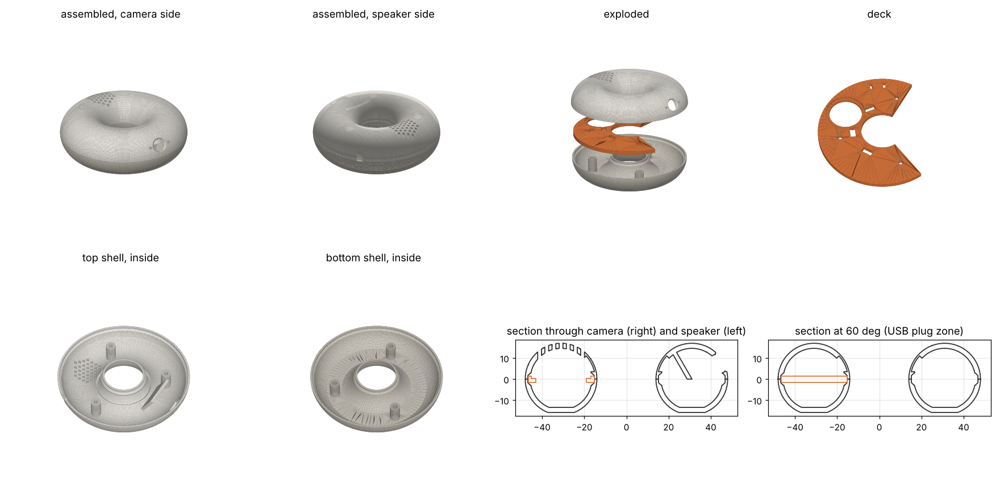

# Donut enclosure, v0

Printable shell for the party-game device: a screenless doughnut with one camera eye,
a speaker grille, a light ring in the centre hole and a captive USB-C cable.



| Size | Outside | Speaker | Use |
|---|---|---|---|
| `puck` | 96 × 33 mm, 28 mm hole | 28 mm round | Closest to the "hockey puck" proportions. Small speaker, so quiet. |
| `party` | 120 × 47 mm, 24 mm hole | 40 mm round, up to 20 mm deep | Loud enough for a room. Print this one if in doubt. |

Files are in `out/<size>/`: `top`, `bottom`, `deck` as `.stl` (slicer) and `.step` (CAD/CAM).

## Print

- All three parts print without supports. `top` and `bottom` go **seam face down**
  (the bottom shell ends up foot-side up). `deck` prints flat.
- 0.2 mm layers, 3 perimeters, 15% infill. PLA or PETG.
- Print `top` in white or natural filament if you want the LED ring to glow through
  the thinned band around the centre hole.
- Roof of each half is a 45° arch closed by a 13 mm bridge; the grille holes are vertical.

## Parts

| Part | Notes |
|---|---|
| Seeed XIAO ESP32S3 Sense | 21 × 17.8 × 15 mm with the camera board fitted |
| MAX98357A I2S amp breakout | 19.4 × 17.8 mm, tapes under the deck |
| Speaker, 4 Ω 2–3 W | 28 mm (`puck`) or 40 mm (`party`) |
| USB-C cable | stays plugged in; plug overmould up to about 12 × 6.5 × 35 mm |
| 3 × M3 × 20 socket-head screws | thread into the top shell (M3 × 30 for `party`) |
| WS2812 strip, 5 mm wide, about 6 LEDs | optional, sticks inside the centre-hole wall |
| Foam tape, small zip tie | board mount and cable strain relief |

## Assemble

1. Flash the XIAO first. After assembly the USB port is only reachable through the cable.
2. Lay `top` upside down. Foam-tape the back of the XIAO to the tilted shelf with the
   camera in the square nest behind the eye and the USB-C port pointing counter-clockwise
   (seen from above the finished device). Slide the board until the lens is centred in
   the hole before pressing it down.
3. Plug in the USB-C cable. The plug lies inside the tube; lead the cable round the
   outside of the first screw boss and drop it into the exit slot.
4. Glue the speaker rim into the recess on the deck, cone towards the grille. Tape the
   amp to the underside. Zip-tie the cable to the two slots beside the exit.
5. Drop the deck into the top shell, fit `bottom`, and drive the three screws from the foot.

## Not yet verified

Nothing here has been printed or test-fitted. Check these on the first print:

- **Camera position on the board.** The shelf is oversized so the board can slide, but the
  nest assumes the lens sits near the middle of the board.
- **Speaker fit.** `puck` leaves about 1.5 mm of deck either side of a 28 mm speaker.
- **USB plug length.** Long overmoulds may foul the boss at 100°; a short or right-angle plug fixes it.
- **Microphone pickup.** The two pinholes beside the eye are a guess at the mic position.
- **`FIT`** (0.15 mm per side) suits a well-tuned printer; raise it to 0.25 if the deck is tight.

## Change it

Every dimension is a named constant at the top of `donut.py`.

```
pip install build123d trimesh matplotlib shapely
python donut.py --size party     # rebuild STL + STEP
python preview.py party          # redraw out/party/preview.png
```
